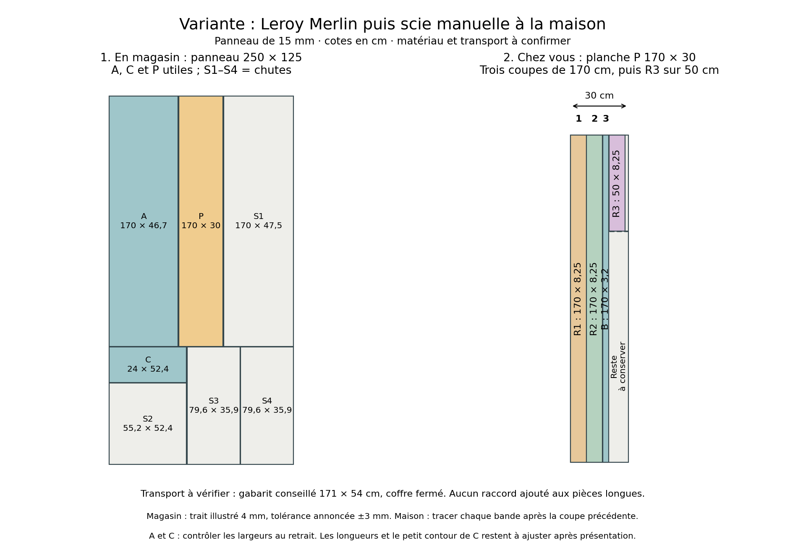

## Hypothèse et matière

Variante demandée : faire les grandes découpes au magasin, puis les bandes
étroites avec votre scie japonaise. Épaisseur conservée : **1,5 cm**.
Le panneau n’est pas acheté : OSB/3[^osb] initialement proposé, ou
contreplaqué[^cp] tout peuplier A+ si une référence est trouvée.
**Le contreplaqué vu chez Leroy Merlin est classé A, pas A+**, selon votre
relevé ; aucun contreplaqué A+ de ce magasin n’est confirmé.
Le placement utilise ici un panneau de **250 × 125 cm** ; un autre
format doit être recalculé avant commande.

## À commander au magasin — trois morceaux utiles

| Repère | Quantité | Longueur × largeur | Destination |
|:--|--:|:--|:--|
| **A** | 1 | **170 × 46,7 cm** | Façade T2–T3 |
| **C** | 1 | **24 × 52,4 cm** | Haut du passage |
| **P** | 1 | **170 × 30 cm** | Planche à recouper pour B et R1–R3 |

Ces trois formats respectent les minimums publiés : **20 × 20 cm ou
60 × 10 cm**. Leroy Merlin annonce **±3 mm** : mesurer A et C au retrait,
car cette tolérance peut consommer les jeux proposés de 3 mm au mur/bois.
Une reprise peut rester nécessaire ; demander un contrôle avant départ.
Ne pas demander directement B à 3,2 cm ou les retours[^retour] à 8,25 cm.

**Pour transporter toutes les chutes[^chute] :** demander aussi de partager
en deux le bloc large restant au-dessus de A/P, comme sur le schéma.
Avec une perte de lame[^trait] de 0,4 cm, cela donne : **S1 : 170 × 47,5 ; S2 : 55,2 × 52,4 ; S3 : 79,6 × 35,9 ; S4 : 79,6 × 35,9 cm**.
Leurs dimensions sont indicatives : l’opérateur adapte aux pertes réelles.
Tous ces restes dépassent également les minimums de coupe.
Le schéma correspond à **six coupes droites au total**, à confirmer par
l’opérateur ; aucun tarif total n’est déduit du nombre de coupes.

## Transport : mesure encore manquante

La voiture et ses dimensions utiles ne sont pas connues. Les morceaux
utiles s’inscrivent, empilés et orientés, dans **170 × 52,4 cm** ; il faut
**4,5 cm d’épaisseur** pour les trois. Avec les quatre chutes fractionnées,
compter **sept morceaux, soit 10,5 cm d’épaisseur de bois**, hors protection.
Tester un carton de **171 × 54 cm** : ouverture du coffre, chemin de chargement,
place disponible avec les sièges rabattus et coffre fermé. Cette marge ne
constitue pas une validation pour votre véhicule. Arrimer les morceaux.
Si les chutes ne sont pas souhaitées, demander si le magasin accepte de
les conserver ; ne pas supposer ce service acquis. Si 170 cm ne rentre pas,
**ne pas couper les grandes pièces en deux sans revoir les raccords et leurs appuis**.

\newpage

## Chez vous : découper P, étape par étape

{ width=100% }

1. Sur P **170 × 30 cm**, tracer **R1 de 8,25 cm de large** depuis un bord
   droit. Scier sur les 170 cm, du côté du bois à écarter, sans retirer le trait utile.
2. Depuis le nouveau bord droit de la planche restante, retracer **R2 à 8,25 cm**,
   puis scier sur 170 cm. Ne pas cumuler les cotes sans tenir compte de la lame.
3. Depuis le bord restant, tracer **B à 3,2 cm**, puis scier sur 170 cm.
4. Dans ce qui reste, prélever un morceau de **50 cm de long**, puis le recouper
   à **8,25 cm de large** pour R3. La partie de 50 cm est une réserve : sa
   longueur finale sera mesurée entre les deux retours présentés.

Il reste donc **trois coupes longues de 170 cm et une de 50 cm**, soit environ
**5,6 m de sciage dans la longueur**, plus les coupes en travers et les
ajustements. Cette variante évite une machine à acheter, mais reste un travail
manuel conséquent. Les quatre pièces longues restent d’un seul tenant.

## Présentation, ajustements et sécurité

Raccourcir A/B/R1/R2 selon leur position réelle ; vérifier les marches sur
toute la largeur de A. Ajuster la hauteur et le petit contour en angle de C.
Le dessous de la traverse[^traverse] posée est à **166,8 cm** ; les hauteurs
170/24 cm sont des réserves, pas toutes des hauteurs finies.

Utiliser une table stable, les deux serre-joints[^serrejoint] et un trait
de crayon sur toute la longueur. Maintenir le morceau conservé, dégager le
trajet de la scie de la table et de toute pièce métallique, et repositionner
le panneau après arrêt de la coupe si nécessaire. Soutenir la bande en fin
de coupe sans refermer le passage de la lame. Faire un essai sur une chute
avant les bandes utiles et poncer les bords. Cette fiche ne valide pas la
stabilité d’une installation de sciage non observée.

Source : [service officiel Leroy Merlin](https://www.leroymerlin.fr/services/decoupe/decoupe-du-bois.html),
consulté le 29 octobre 2026. Les dimensions proviennent de `donnees/geometrie.json`.

[^osb]: **OSB** : panneau de grandes lamelles de bois collées.
[^cp]: **Contreplaqué** : panneau formé de fines feuilles de bois collées en couches croisées.
[^retour]: **Retour** : panneau couvrant l’épaisseur de la cloison à l’intérieur du passage.
[^chute]: **Chute** : morceau restant après découpe.
[^trait]: **Perte de lame** : largeur de bois retirée lors du sciage.
[^traverse]: **Traverse** : bois horizontal placé au-dessus du passage.
[^serrejoint]: **Serre-joint** : outil maintenant fermement le bois contre la table.
