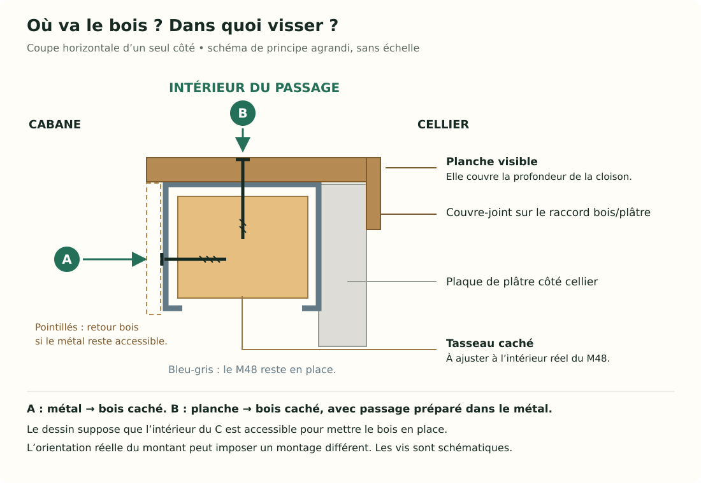
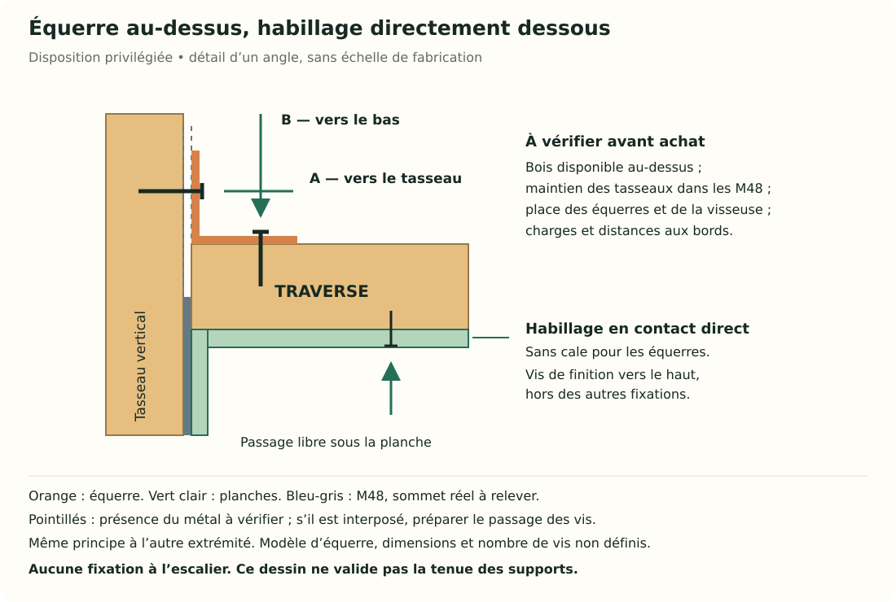

Le montage proposé forme **un petit tunnel en bois à travers la cloison** : une planche à gauche, une à droite et une au-dessus. Ces trois planches cachent les bords du métal et du plâtre autour du passage. Les montants M48[^montant] restent en place.

## Les faits et les limites du dessin

Vous avez mesuré **47 cm entre les montants de T1** et **174 cm sous plafond à ses deux extrémités**. Une plaque de plâtre est présente côté cellier ; l’ossature[^ossature] est visible côté cabane. Les deux montants n’ont pas nécessairement leur face ouverte tournée dans le même sens.

**Précision sur l’existant :** vous indiquez que les M48 s’arrêtent avant le haut du mur. Leurs extrémités ne sont donc pas à assimiler à la hauteur sous plafond de 174 cm. Leurs hauteurs exactes et leur liaison éventuelle à une pièce métallique supérieure restent à établir ; un montant qui s’arrête sous le plafond peut néanmoins être relié à cette pièce.

**Proposition :** fixer les planches de finition sur des supports de bois cachés, eux-mêmes fixés aux montants. Le schéma montre le cas où la face pleine du montant est tournée vers le passage. L’orientation et l’accessibilité réelles de chaque montant restent à vérifier pour choisir le détail de fixation.

**Mesures manquantes :** l’épaisseur réelle à couvrir à travers la cloison, la place disponible dans les montants pour les supports, la hauteur des sommets des M48 et la disposition de leurs fixations supérieures. Ces données permettent de positionner le support du haut. La hauteur finale des planches ne se déduit donc pas directement des 174 cm sous plafond.

**Point de sécurité :** cette fiche explique la finition. La fonction mécanique de la cloison et des appuis doit être vérifiée avant découpe ; l’habillage ne constitue pas un support de l’escalier. Aucune fixation dans l’escalier ou son poteau n’est proposée ici.

## 1. Comprendre la place de chaque pièce

Un montant M48 est une pièce creuse en métal, de forme proche d’un C. Le petit bois caché dedans est un **tasseau**[^tasseau]. La planche visible, par exemple en **contreplaqué**[^contreplaque], vient ensuite du côté de l’ouverture.

Ce dessin est une **coupe horizontale**[^coupe] agrandie, sans échelle de fabrication. Il représente un seul côté de l’ouverture, avec la face pleine métallique entre le passage et le support bois. Il faut adapter le montage si le C s’ouvre vers le passage.

- **A — fixer le support caché :** la vis traverse une face métallique accessible et prend dans le tasseau. Cela empêche le tasseau de se déplacer.
- **B — fixer la planche visible :** la vis part du passage, traverse la planche et prend dans le tasseau. Si une face métallique est interposée, son passage doit être prépercé[^prepercage] ; une vis à bois ordinaire ne perce pas nécessairement le métal.

La vis B doit donc rencontrer du bois derrière la planche. Il faut préparer ce support avant de fermer la finition.

## 2. Mettre le bois de fixation dans le montant

Présentez d’abord **un petit morceau de tasseau** dans la partie ouverte et accessible du montant, pour vérifier la place disponible. Sa section[^section] est choisie d’après l’intérieur réel du montant : les petits bords repliés du métal peuvent gêner son introduction. Le nom « M48 » ne suffit pas à choisir les dimensions du tasseau.

Si la forme du montant et l’accès le permettent, ajustez ensuite le support vertical à la hauteur nécessaire. Il doit être stable, accessible au vissage et assez profond pour recevoir les vis de la planche. Fixez-le par la face métallique accessible, avec des vis adaptées à la liaison métal mince–bois. Repérez les câbles ou conduites avant tout perçage et adaptez la longueur pour que les pointes ne ressortent pas.

**Si le bois ne peut pas être introduit**, ne forcez pas et ne découpez pas les bords du montant pour le faire entrer. Le montage doit alors être adapté, par exemple avec un support fixé devant le métal. Cette variante réduit davantage le passage : les calculs de 44 ou 44,6 cm ci-dessous ne s’y appliquent plus tels quels.

## 3. Découper les deux planches verticales

Chaque côté vertical de l’ouverture est un **jambage**[^jambage]. Pour sa planche, trois dimensions sont à distinguer :

| Dimension de la planche | Comment la déterminer |
|---|---|
| **Longueur verticale** | Du sol au dessous du support supérieur prévu ; elle reste à définir. |
| **Largeur à travers la cloison** | Du bord à recouvrir côté cabane à la face finie côté cellier ; mesurer sur place. |
| **Épaisseur du panneau** | Hypothèses comparées : 1,2 ou 1,5 cm, soit 12 ou 15 mm. |

La planche verticale sera donc une bande étroite. **Elle ne fait pas 47 cm de large** : les 47 cm sont l’espace entre les deux montants. Sa largeur couvre l’épaisseur de la cloison. Avec un profil nominal de 4,8 cm et une plaque BA13[^ba13] de 1,25 cm, on obtiendrait environ **6,05 cm** ; c’est un exemple à remplacer par la mesure réelle, surtout s’il faut couvrir un bord supplémentaire côté cabane.

Présentez les deux planches sans les fixer définitivement. Vérifiez qu’elles sont verticales, qu’elles reposent correctement sur leurs supports et qu’elles recouvrent les bords accessibles autour du passage. Les pièces de bois cachées ne doivent pas dépasser dans la largeur utile si l’on souhaite ne perdre que l’épaisseur des panneaux.

## 4. Visser les planches sur les supports bois

Repérez sur chaque planche les zones où se trouve le tasseau derrière. Prépercez la planche et préparez légèrement le logement des têtes de vis pour qu’elles ne dépassent pas. Lorsque du métal est interposé, préparez également le passage dans ce métal, sans abîmer le bois destiné à recevoir le filetage[^filetage].

Vissez depuis l’intérieur du passage vers le tasseau, comme la vis **B** du dessin. La longueur des vis doit traverser le panneau et atteindre suffisamment le bois, sans ressortir à l’arrière. Elle dépend de l’épaisseur et de la position du support ; aucune longueur universelle n’est fixée ici. Serrez progressivement, sans écraser le panneau ni déformer le montant.

Répartissez les fixations sur la hauteur en fonction des supports réellement présents. Une planche correctement tenue ne doit pas basculer ni se soulever sous la main. La colle peut compléter une finition, mais le montage décrit repose sur des fixations mécaniques dans le bois.

## 5. Poser la planche du haut

Le dessus reçoit une troisième planche. Elle se fixe à une **traverse**[^traverse] ou à un support supérieur adapté, dont la disposition doit être définie avant la découpe de la plaque. La planche de finition ne doit pas être chargée de tenir à elle seule le plâtre conservé au-dessus.

**Oui, le principe envisagé est bien deux supports de bois verticaux dans les M48, reliés par une traverse horizontale**, puis recouverts par les trois planches de finition. Mais la liaison de la traverse aux côtés doit se faire dans des zones offrant une fixation suffisante. La traverse peut se situer plus bas que les sommets des montants ; les bois verticaux n’ont pas besoin d’aller jusqu’au plafond pour ce montage. Il ne faut pas compter sur deux morceaux de tasseau dépassant librement des M48 pour tenir le haut sans avoir vérifié leur liaison et leur tenue.

### Comment relier la traverse aux tasseaux ?

**Disposition privilégiée à la demande de l’utilisateur : une équerre métallique[^equerre] au-dessus de la traverse, à chaque extrémité.** Sa branche verticale se fixe dans le tasseau qui dépasse au-dessus ; sa branche horizontale se fixe sur le dessus de la traverse. Le dessous reste libre pour recevoir directement la planche d’habillage.

**Hypothèses à vérifier :** les tasseaux dépassent suffisamment au-dessus de la traverse, leur maintien dans les M48 est suffisant et les faces nécessaires restent accessibles. Dépasser la traverse ne signifie pas nécessairement dépasser le sommet du M48. Si du bois dépasse aussi le métal, sa tenue doit être vérifiée ; cette longueur libre ne constitue pas à elle seule un support validé.

**Mesures manquantes avant achat :** dimensions utiles des bois, hauteur disponible au-dessus de la traverse, hauteur des sommets des M48, espace pour la visseuse et distances nécessaires entre les fixations et les extrémités du bois. La charge à reprendre, notamment celle du plâtre conservé, doit également être déterminée pour choisir les liaisons.

1. Présentez la traverse horizontalement à la hauteur retenue après vérification des supports. Maintenez-la provisoirement pendant la fixation.
2. Placez la première équerre **sur le dessus de la traverse**, avec sa branche verticale contre le tasseau au-dessus de celle-ci.
3. Fixez la branche verticale : les vis vont **horizontalement dans le tasseau**. Si une face du M48 est interposée, préparez le passage dans le métal ; vérifiez la présence de bois derrière chaque fixation.
4. Fixez la branche horizontale : les vis vont **de haut en bas dans la traverse**, sans ressortir sous le bois.
5. Réalisez la même liaison à l’autre extrémité et vérifiez la fixation de l’ensemble avant de retirer le maintien provisoire.

Les dimensions des équerres, leurs vis et le nombre de fixations se choisissent ensemble, selon le bois disponible, les charges et la documentation du fabricant pour cette disposition. Le dessin indique les directions de vissage, **pas un nombre de vis validé ni des dimensions à acheter**. La [fiche fabricant Simpson Strong-Tie](https://www.simpson.fr/fr-FR/produits/equerre-simple-es) reste une référence générale ; elle ne constitue ni le choix d’un modèle ni une validation de ce montage particulier.

### Habiller directement le dessous de la traverse

Dans cette disposition, **aucune branche d’équerre ni tête de vis de liaison ne se trouve entre la traverse et la planche supérieure**. Présentez la planche contre le bois, puis vissez-la de bas en haut dans la traverse. Repérez les vis de liaison déjà présentes pour éviter de les rencontrer. Les vis de finition doivent tenir dans le bois sans ressortir au-dessus.

Les branches verticales des équerres restent au-dessus de l’ouverture. Elles ne nécessitent donc pas de calage derrière les planches latérales du passage dans ce montage. Vérifiez néanmoins que les supports et les autres fixations ne dépassent pas dans la largeur utile, et que le métal accessible côté cabane reste recouvert.

Les cales[^cale] sous la traverse **ne font plus partie du montage ni des achats prévus**. L’ancienne variante avec équerres dessous et cales est conservée dans l’historique. Si les vérifications empêchent la disposition supérieure, il faudra revoir le détail avant achat et découpe, sans réintroduire automatiquement cette ancienne variante.

**Objectif proposé pour l’accès :** conserver la plus grande hauteur utile compatible avec un encadrement correctement fixé, afin de faciliter le passage des enfants et l’intervention d’un adulte. On détermine d’abord le niveau du dessous de la traverse, puis on soustrait l’épaisseur de la planche qui l’habille :

`hauteur finie = hauteur du dessous de la traverse − épaisseur de la planche supérieure`

Cette formule suppose que la planche repose directement contre le bois, sans cale ni autre pièce interposée. Placer les équerres au-dessus simplifie l’habillage, mais ne garantit pas une ouverture plus haute : il faut garder la place nécessaire pour les équerres et leur vissage au-dessus de la traverse.

Les deux hauteurs sont prises depuis le même sol fini. Cette formule ne fixe aucune cote de découpe tant que la traverse n’est pas positionnée. Sa position dépend des supports disponibles et de leurs fixations, pas seulement des 174 cm sous plafond.

Dans la disposition proposée, les deux planches verticales montent jusqu’au support supérieur et la planche horizontale vient **entre elles**. Sa longueur théorique vaut alors :

| Épaisseur des planches latérales | Longueur de la planche du haut, entre les côtés | Largeur de passage correspondante |
|---|---:|---:|
| 1,2 cm chacune | 47 − 1,2 − 1,2 = **44,6 cm** | **44,6 cm** |
| 1,5 cm chacune | 47 − 1,5 − 1,5 = **44 cm** | **44 cm** |

Reprenez cette longueur entre les planches installées avant la coupe définitive. Ces valeurs supposent que seuls les panneaux latéraux prennent de la place dans les 47 cm ; un tasseau ou une cale[^cale] ajouté devant le métal réduirait encore cette largeur.

La largeur de la planche du haut couvre, elle aussi, l’épaisseur réelle de la cloison. La hauteur finie du passage est la distance entre le sol et le dessous de cette planche. **On ne peut pas annoncer 172,5 cm en soustrayant seulement 1,5 cm aux 174 cm** : il faut d’abord connaître la place occupée par le support supérieur.

## 6. Masquer les raccords et adoucir les bords

Côté cellier, une fine baguette appelée **couvre-joint**[^couvrejoint] peut chevaucher le raccord entre le bois et le bord découpé du plâtre. Elle se fixe au bois du cadre, sans compter sur le bord fragile de la plaque pour la tenir.

Côté cabane, regardez ce qui reste accessible une fois le panneau posé. Si une partie métallique reste exposée à proximité du passage, complétez la finition par une petite bande de retour[^retour] ou un couvre-joint, fixés au bois. Cela se décide d’après la forme réelle ; trois planches ne recouvrent pas automatiquement toutes les faces des montants.

Poncez les surfaces et les **chants**[^chant], adoucissez les coins, puis vérifiez qu’aucune tête de vis, pointe ni arête[^arete] métallique ne reste accessible dans le passage. Le **rail au sol**[^rail] constitue un sujet distinct : cette finition ne suffit pas à supprimer le seuil métallique ; son rôle et ses attaches doivent être vérifiés avant toute intervention.

## 7. Achats prévisionnels pour la disposition retenue

Cette liste concerne l’habillage actuel de T1 et remplace, pour ce montage, les indications d’achat du guide historique. **Les quantités de pièces décrivent le principe ; les dimensions et références non vérifiées restent à déterminer avant achat.** Les 47 cm mesurés ne constituent pas à eux seuls une longueur de coupe définitive.

| Fourniture | Quantité envisagée | À déterminer avant achat |
|---|---:|---|
| Supports bois verticaux (tasseaux) | 2 pièces | Section compatible avec l’intérieur réel des M48 ; longueur permettant la fixation au-dessus de la traverse et un maintien suffisant dans les montants. |
| Traverse en bois | 1 pièce | Section selon les charges et fixations ; longueur entre les supports réellement installés. |
| Équerres pour le dessus de la traverse | 2 pièces, une par extrémité | Modèle compatible avec la disposition, les charges, la largeur des bois, les distances aux bords et l’accès de vissage. |
| Vis de liaison des équerres aux bois | Quantité à définir | Type, diamètre, longueur et nombre selon le modèle d’équerre et les bois ; ne pas les remplacer par des vis de finition choisies au hasard. |
| Fixations des supports bois aux M48 | Quantité à définir | Compatibilité métal mince–bois et tenue requise ; dimensions selon le montage réel. |
| Planches d’habillage | 3 bandes : 2 côtés et 1 dessus | Épaisseur à choisir (hypothèses : 1,2 ou 1,5 cm), profondeur réelle de cloison et longueurs finales. |
| Vis de finition | Quantité à définir | Longueur selon panneau et bois disponible, sans pointe sortante ni collision avec les autres vis. |
| Fixations du plâtre conservé au support supérieur | Selon la disposition vérifiée | Type et quantité à définir avec le maintien de la plaque avant découpe. |
| Couvre-joints ou bandes de retour | En option, quantité à mesurer | Seulement selon les raccords et les parties métalliques encore accessibles. |

**Exclusion du montage retenu :** pas de cales à acheter pour compenser des équerres sous la traverse. Les achats liés à la ventilation et à l’éclairage restent distincts de cette liste.

## Références techniques et portée de la proposition

La [fiche Knauf du montant 48/35](https://knauf.com/fr-FR/p/produit/montant-48-35-22807_4091) décrit le profil standard pris comme exemple. Le [carnet de pose Siniat, page 99](https://www.siniat.fr/siteassets/page-assets/fr/siniatheque/carnet-de-pose/pdf/carnet-de-pose-siniat-2021?v=4ae11e) illustre des liaisons vissées entre ossature métallique et encadrement en bois pour des portes légères. Ces documents servent de repères ; le détail de finition proposé ici doit être adapté à la cloison photographiée et ne reprend pas un système de porte complet validé par un fabricant.

[^montant]: **Montant M48** : élément métallique vertical de la cloison, de forme proche d’un C, prévu pour une ossature d’environ 48 mm de profondeur.
[^ossature]: **Ossature** : ensemble des éléments qui maintiennent les plaques de la cloison.
[^tasseau]: **Tasseau** : petite pièce de bois allongée servant ici de support pour les vis.
[^contreplaque]: **Contreplaqué** : panneau constitué de fines couches de bois collées en directions croisées.
[^coupe]: **Coupe horizontale** : dessin montrant les matériaux comme si l’on avait coupé l’ensemble à une hauteur donnée pour le regarder par-dessus.
[^section]: **Section** : largeur et épaisseur d’un tasseau vues lorsqu’on regarde son extrémité.
[^jambage]: **Jambage** : côté vertical d’une ouverture.
[^ba13]: **BA13** : plaque de plâtre courante d’environ 12,5 mm d’épaisseur.
[^prepercage]: **Préperçage** : réalisation d’un trou avant la pose d’une vis, adapté à son passage ou à son diamètre de fixation.
[^filetage]: **Filetage** : partie en spirale de la vis qui s’accroche au matériau.
[^traverse]: **Traverse** : pièce horizontale reliant les côtés d’un encadrement.
[^equerre]: **Équerre métallique** : pièce pliée à angle droit ; chacune de ses deux branches se fixe à l’une des pièces à relier.
[^cale]: **Cale** : petite pièce interposée pour ajuster une position ou combler un écart.
[^couvrejoint]: **Couvre-joint** : baguette qui masque le raccord entre deux matériaux.
[^retour]: **Bande de retour** : pièce de finition qui tourne sur une face voisine pour la recouvrir.
[^chant]: **Chant** : bord étroit d’une planche, correspondant à son épaisseur.
[^rail]: **Rail** : pièce métallique horizontale dans laquelle viennent se placer les montants.
[^arete]: **Arête** : ligne de rencontre de deux faces ; une arête vive est un bord non adouci qui peut être coupant.
