\begin{titlepage}
\thispagestyle{empty}
\centering
\vspace*{0.8cm}
{\Huge\bfseries Créer une entrée entre le cellier et la cabane sous l'escalier\par}
\vspace{0.5cm}
{\Large Guide de chantier pas à pas\par}
\vspace{0.9cm}
\includegraphics[width=0.82\textwidth]{images/couverture_resultat_prevu.png}
\vspace{0.7cm}

{\large Ouverture entre deux montants existants, habillage en bois, préparation de la ventilation et de l'éclairage\par}
\vfill
{\small Visualisation indicative du résultat prévu, vue depuis la cabane. Le cellier mesure 115 cm selon l'axe ouest-est ; l'image de couverture n'est pas une vue métrique.\par}
{\small Version 1.0 -- septembre 2026\par}
\end{titlepage}

# 1. Objet du chantier

L'objectif est de créer un passage entre le cellier et l'espace situé sous l'escalier, destiné à devenir une petite cabane pour les enfants.

La cloison existante est constituée d'une **ossature métallique**[^ossature] visible depuis la cabane et d'une seule **plaque de plâtre BA13**[^ba13] côté cellier. Aucun isolant n'est visible entre les deux faces. Les éléments verticaux visibles sont des **montants M48**[^m48] et le **profilé**[^profile] horizontal au sol est un **rail R48**[^r48].

Le cellier mesure **115 × 180 cm** : 115 cm selon l'axe ouest-est et 180 cm selon l'axe sud-nord. Vu depuis la cabane, en regardant vers le cellier, le mur est se trouve donc à seulement 115 cm de la cloison ouest. Cette cote est importante pour interpréter les visualisations : le cellier est un volume étroit, et non une pièce profonde.

Le principe retenu est volontairement simple : réaliser l'ouverture dans la **travée**[^travee] située **entre le montant proche du mur nord et le montant central**, sans supprimer de montant vertical. L'ancienne hypothèse d'une ouverture de 80 cm dans le mur ouest est abandonnée. La mesure actuelle donne environ 53 cm entre les repères observés. Avant toute découpe, la largeur réellement disponible doit être remesurée **entre les faces intérieures des deux montants** : la photographie panoramique est déformée et la mesure de 53 cm ne doit pas être utilisée comme cote de fabrication définitive.

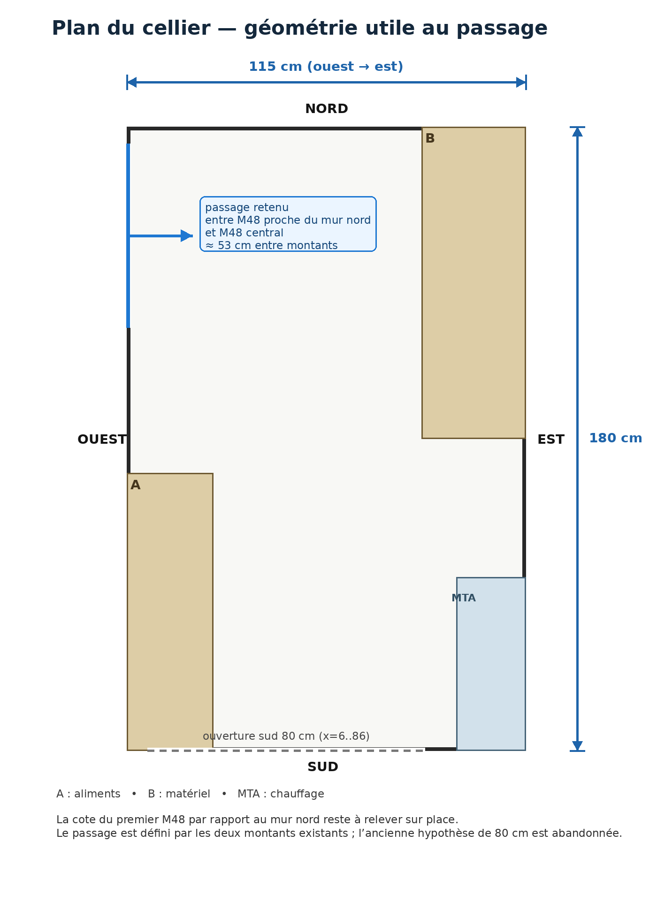{ width=72% }

La hauteur maximale observée sous l'escalier est d'environ 188 cm au point mesuré. La hauteur de l'ouverture doit être choisie d'après la hauteur réellement disponible sur toute sa largeur, car la sous-face de l'escalier est inclinée.

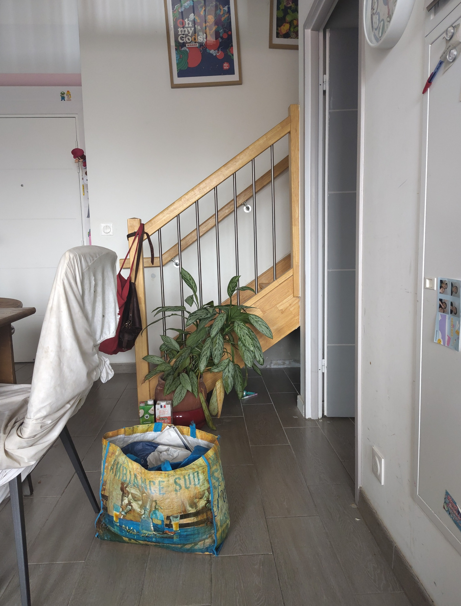{ width=58% }

\newpage

# 2. État existant

## 2.1 Cloison vue depuis la cabane

La photographie panoramique montre la plaque de plâtre côté cellier et les montants métalliques accessibles depuis la cabane. Le passage envisagé se trouve dans la **travée**[^travee] située entre le montant proche du mur nord et le montant central.

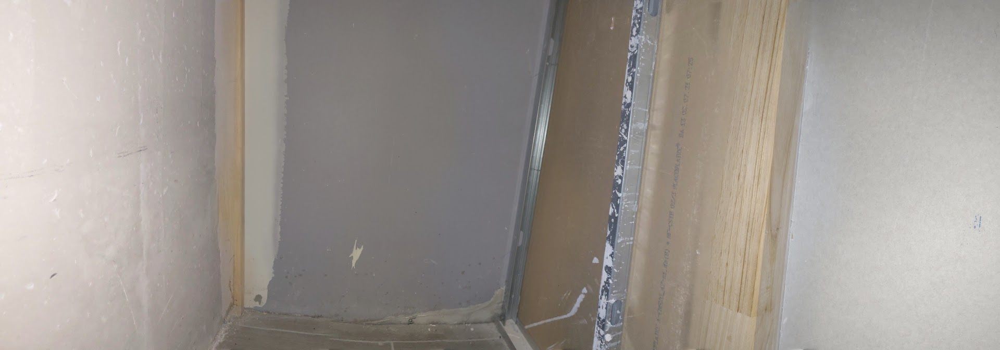{ width=100% }

La partie haute montre que les montants rejoignent la zone sous l'escalier. Le haut de l'ouverture doit rester suffisamment bas pour conserver une pièce horizontale rigide au-dessus du passage.

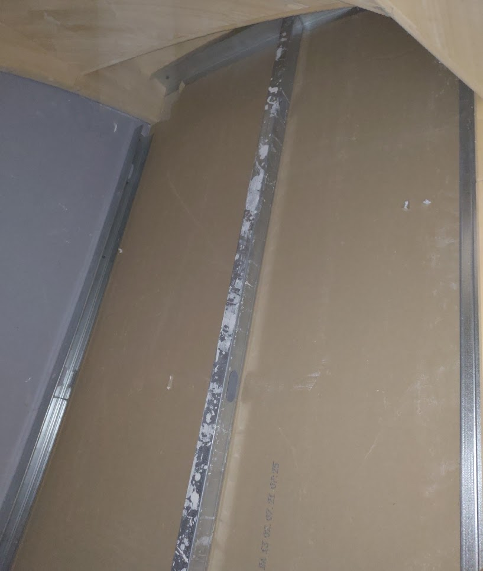{ width=64% }

## 2.2 Mesures disponibles

La mesure au sol permet de repérer la position du montant central et du rail. La largeur brute doit être reprise au mètre avant le traçage final. La photographie annotée ci-dessous matérialise la travée effectivement retenue : elle est comprise entre le M48 proche du mur nord et le M48 central.

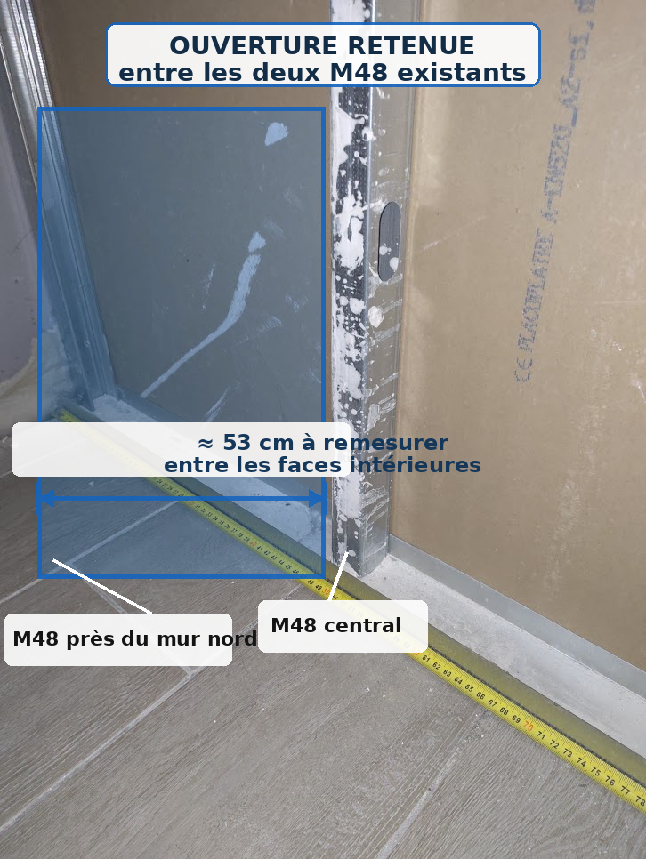{ width=62% }

La photographie d'origine avec le mètre reste utile pour contrôler la cote et la position du rail au sol.

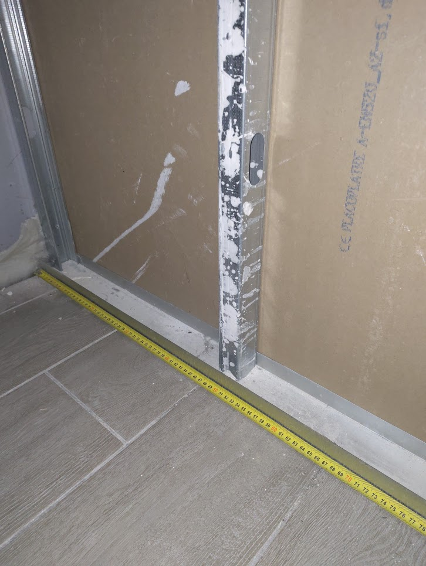{ width=48% }

La hauteur maximale mesurée sous l'escalier est proche de 188 cm.

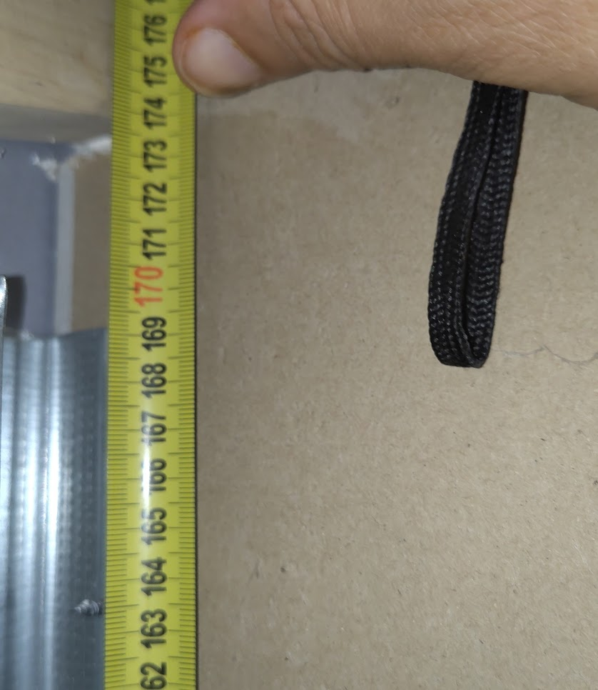{ width=58% }

\newpage

# 3. Principe de construction retenu

Aucun montant vertical n'est supprimé. On conserve les deux M48 qui délimitent naturellement la future entrée. La plaque de plâtre est découpée entre eux, puis seule la portion du rail au sol qui traverse le passage est retirée.

Une **traverse haute**[^traverse] est ajoutée entre les deux montants avant la découpe finale. Cette pièce soutient le bord inférieur de la plaque de plâtre qui restera au-dessus de l'ouverture et fournit un support solide pour la finition.

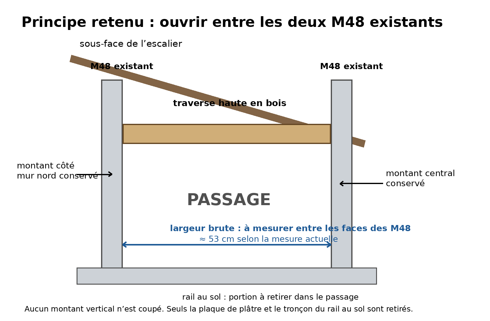{ width=100% }

Cette méthode présente quatre avantages : elle évite de modifier la trame principale de la cloison, réduit le nombre de découpes métalliques, facilite l'obtention d'une ouverture droite et laisse un support clair pour l'habillage en bois.

# 4. Matériel et outillage

Les dimensions du bois sont à adapter après mesure réelle de la cloison.

| Élément | Usage |
|---|---|
| Mètre ruban, crayon, règle et niveau | Mesurer et tracer l'ouverture |
| Équerre[^equerre] | Tracer les angles droits |
| Outil multifonction oscillant[^multifonction] avec lame pour plâtre | Découper précisément le BA13 |
| Lame métal pour outil oscillant ou cisaille à tôle[^cisaille] | Couper le rail R48 au sol |
| Perceuse-visseuse[^visseuse] | Fixer les pièces de bois et les renforts |
| Tasseaux[^tasseau] de bois, typiquement autour de 30 × 40 mm | Renforcer les deux côtés et le haut de l'ouverture |
| Contreplaqué[^contreplaque] de 12 à 15 mm | Former les trois surfaces intérieures du passage |
| Vis à bois | Fixer le contreplaqué sur les tasseaux |
| Vis autoforeuses[^autoforeuse] pour métal si nécessaire | Fixer un renfort à l'ossature métallique |
| Baguettes de finition / couvre-joints[^couvrejoint] | Masquer proprement la jonction bois-plâtre côté cellier |
| Papier abrasif[^abrasif] | Arrondir et lisser les arêtes du bois |
| Lunettes de protection et masque à poussière | Protection pendant les découpes |

Il est préférable d'acheter le contreplaqué après avoir ouvert et mesuré précisément l'épaisseur totale de la cloison. Une approximation raisonnable est 48 mm de montant métallique plus environ 12,5 mm de BA13, soit environ 60 mm, mais la cote réelle doit être relevée sur place.

\newpage

# 5. Chantier étape par étape

## Étape 1 -- Tout mesurer avant de couper

Mesurer la largeur libre entre les deux montants M48 choisis, en bas, au milieu et aussi haut que possible. Retenir la plus petite valeur. Mesurer également la hauteur disponible sous l'escalier à gauche et à droite de l'ouverture.

Choisir ensuite une ouverture rectangulaire. Le bord supérieur doit se situer sous le point le plus bas de la sous-face de l'escalier sur toute la largeur du passage. Cette solution est plus simple à construire et à habiller qu'une ouverture suivant la pente.

Tracer sur l'arrière du BA13 :

1. les deux lignes verticales correspondant aux bords du passage ;
2. la ligne horizontale supérieure ;
3. la ligne basse au niveau du sol.

Ne pas chercher à obtenir exactement 53 cm de passage fini. Le passage fini sera légèrement plus étroit que la largeur brute, car l'habillage en contreplaqué prend de la place de chaque côté. Avant de couper, il est utile de matérialiser au sol une largeur d'environ 50 cm avec deux objets ou de fabriquer un **gabarit**[^gabarit] en carton, puis de vérifier qu'un adulte peut encore passer pour le nettoyage et la maintenance.

## Étape 2 -- Vérifier la zone derrière la plaque

Depuis la cabane, inspecter toute la zone qui va être découpée. Aucun câble, tuyau ou élément de l'escalier ne doit traverser le rectangle de découpe.

Cette vérification est particulièrement simple ici puisque la face arrière de la plaque est ouverte et visible. Si un câble est présent dans un montant ou passe derrière la plaque, son chemin doit être modifié avant la découpe.

## Étape 3 -- Poser la traverse haute avant d'ouvrir

La traverse haute peut être réalisée avec un tasseau de bois correctement ajusté entre les deux M48. Elle doit être horizontale et placée immédiatement au-dessus de la future ligne de coupe supérieure.

Pour une réalisation simple :

1. couper un tasseau à la largeur exacte entre les deux montants ;
2. le positionner horizontalement ;
3. le fixer aux deux montants métalliques ;
4. depuis le cellier, ajouter quelques vis à travers le BA13 dans ce tasseau, **au-dessus** de la future ligne de coupe.

Ainsi, la partie de plaque de plâtre qui restera au-dessus de l'ouverture sera maintenue avant même que le morceau inférieur soit retiré.

## Étape 4 -- Découper le BA13

Utiliser l'outil multifonction oscillant avec une profondeur de coupe limitée à environ l'épaisseur de la plaque. L'objectif est de couper le plâtre sans attaquer inutilement les montants métalliques.

Commencer par la ligne horizontale du haut, puis les deux côtés. Terminer par la ligne basse. Le morceau de plaque peut alors être retiré vers le cellier ou vers la cabane selon l'accès le plus simple.

La découpe n'a pas besoin d'être parfaite au millimètre : les petites irrégularités seront masquées plus tard par les baguettes de finition. En revanche, il faut éviter d'arracher une grande zone de carton autour de l'ouverture.

## Étape 5 -- Retirer uniquement le rail au sol dans le passage

Une fois la plaque retirée, le rail R48 au sol devient complètement accessible. Couper uniquement le tronçon situé entre les deux montants conservés.

Les extrémités métalliques restantes doivent terminer au droit des montants et ne laisser aucune pointe ou languette dans le passage. Les bords coupés doivent être limés ou rabattus si nécessaire. Une **arête**[^arete] est la ligne formée par la rencontre de deux faces ; aucune arête métallique vive ne doit rester accessible.

Le passage doit rester aussi plat que possible : une arête métallique saillante au sol serait particulièrement indésirable pour un espace utilisé par des enfants.

## Étape 6 -- Ajouter les tasseaux dans les montants

Insérer un tasseau vertical dans chaque M48 si la forme du profilé le permet. L'objectif est de disposer d'un support en bois dans lequel les futures vis de finition pourront prendre correctement.

Les tasseaux ne sont pas destinés à porter l'escalier. Ils servent uniquement à rigidifier l'encadrement de l'ouverture et à faciliter la fixation du bois de finition.

Ajouter également un tasseau horizontal au-dessus de l'ouverture si la traverse posée à l'étape 3 n'assure pas déjà cette fonction.

## Étape 7 -- Fabriquer les trois pièces d'habillage

L'**habillage**[^habillage] est constitué de trois bandes de contreplaqué : une à gauche, une à droite et une au-dessus. Elles forment une sorte de petit tunnel en bois à travers l'épaisseur de la cloison.

Chaque bande doit avoir une largeur égale à l'épaisseur réelle à couvrir entre la face visible du cellier et le bord côté cabane. Cette dimension doit être mesurée après ouverture.

La hauteur des deux bandes verticales correspond à la hauteur du passage. La bande supérieure est coupée à la largeur comprise entre les deux côtés une fois ceux-ci en place.

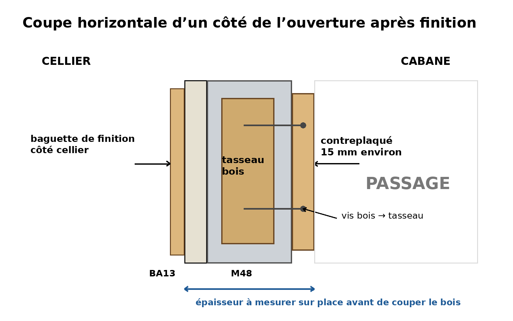{ width=100% }

Le bord étroit visible d'une planche s'appelle son **chant**[^chant]. Pour cette cabane, les chants visibles doivent être poncés et les angles légèrement arrondis.

## Étape 8 -- Visser l'habillage en bois

Présenter d'abord les deux bandes verticales sans les visser définitivement. Vérifier que le passage reste suffisamment large et que les pièces sont d'aplomb[^aplomb].

Visser ensuite chaque bande dans le tasseau placé dans le montant correspondant. Les têtes de vis peuvent être légèrement enfoncées puis masquées avec une pâte à bois[^patebois] si une finition lisse est souhaitée.

Poser enfin la bande horizontale supérieure.

À la fin de cette étape, aucun profilé métallique ne doit être accessible aux mains dans le passage.

## Étape 9 -- Finir la face côté cellier

Le bord du BA13 découpé reste visible autour du nouveau cadre. La méthode la plus simple pour éviter un travail d'**enduit**[^enduit] complexe consiste à poser une petite baguette de bois sur le pourtour côté cellier.

Cette baguette recouvre simultanément quelques millimètres de BA13 et quelques millimètres du cadre en bois. Elle masque ainsi la ligne de découpe.

Le côté cabane peut recevoir la même finition si cela améliore l'aspect, mais ce n'est pas indispensable si le contreplaqué couvre déjà proprement le métal.

## Étape 10 -- Poncer et protéger le bois

Poncer toutes les surfaces accessibles, en insistant sur les quatre coins de l'ouverture et sur les chants. Commencer avec un grain[^grain] moyen, par exemple 120, puis terminer avec un grain plus fin, par exemple 180.

Pour une zone utilisée par des enfants, une finition à base d'eau adaptée au mobilier intérieur est pratique. Le produit doit être complètement sec et durci avant utilisation de la cabane.

\newpage

# 6. Prévoir la ventilation et les LED avant les finitions

Le chantier de l'ouverture est le bon moment pour préparer les passages nécessaires à la ventilation et à l'éclairage, car l'ossature est encore accessible.

La ventilation prévue consiste à utiliser l'ouverture existante côté pièce de vie comme arrivée d'air basse et à extraire l'air chaud en partie haute de la cabane vers le cellier. Le ventilateur doit donc être placé en hauteur, pas au niveau du sol.

Pour l'éclairage, le ruban LED prévu fonctionne en 24 V. L'**alimentation**[^alimentation] 230 V vers 24 V doit rester accessible dans le cellier ; elle ne doit pas être enfermée derrière l'habillage. Seul le câble basse tension peut être amené proprement jusqu'au ruban dans la cabane.

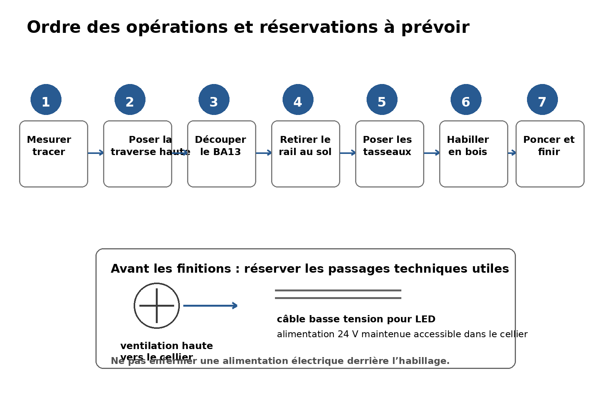{ width=100% }

Il est utile de prévoir les trous et passages de câble avant de poser les baguettes de finition. Cela évite de redémonter l'encadrement ultérieurement.

# 7. Contrôle final

Avant de laisser les enfants utiliser la cabane, vérifier les points suivants :

- aucune arête de métal n'est accessible ;
- aucune vis ne dépasse ;
- les angles du bois sont arrondis et poncés ;
- le passage est libre au sol et ne comporte pas de seuil saillant ;
- les deux montants verticaux d'origine sont toujours en place et solidement fixés ;
- la partie de BA13 située au-dessus de l'ouverture est fixée à la traverse haute ;
- le ventilateur et sa grille sont hors de portée directe des doigts ;
- le câble des LED est protégé contre les arrachements ;
- l'alimentation 24 V reste accessible depuis le cellier ;
- le passage depuis le cellier n'est pas encombré par un rayonnage ou par des objets stockés.

# 8. Résultat visé

Le résultat final est une petite ouverture encadrée de bois, volontairement plus petite qu'une porte normale. Elle est placée dans la travée comprise entre le M48 proche du mur nord et le M48 central. Elle doit donner l'impression d'une entrée de cabane. La largeur finale doit être testée avant découpe afin de conserver un accès de maintenance acceptable pour les adultes du logement.

Le cellier visible derrière cette ouverture ne fait que 115 cm selon l'axe ouest-est. La visualisation ci-dessous sert à montrer l'intention d'aménagement et l'encadrement en bois ; les cotes du plan et les photographies annotées font référence pour la géométrie réelle.

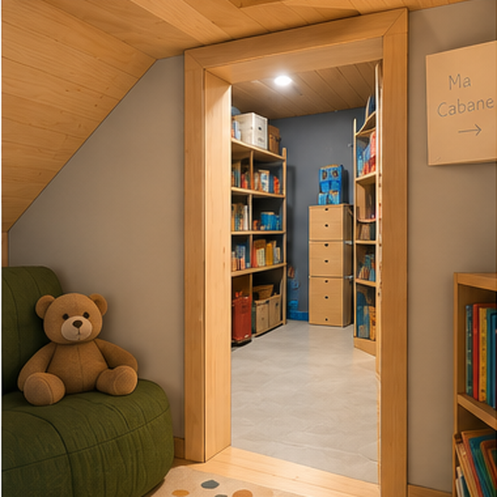{ width=68% }

La largeur finale dépendra de la mesure brute entre les deux M48 et de l'épaisseur choisie pour l'habillage. Avec un contreplaqué de 15 mm de chaque côté, la largeur finie est environ 30 mm inférieure à la largeur brute.

---

[^profile]: **Profilé** : pièce longue dont la section garde la même forme sur toute sa longueur. Les M48 et R48 sont des profilés métalliques minces.
[^travee]: **Travée** : espace compris entre deux montants verticaux successifs d'une ossature.
[^visseuse]: **Perceuse-visseuse** : outil électrique capable de percer avec un foret et de visser avec un embout adapté.
[^gabarit]: **Gabarit** : modèle aux dimensions prévues utilisé pour vérifier une forme ou un passage avant de fabriquer la pièce définitive.
[^arete]: **Arête** : ligne formée par la rencontre de deux faces d'une pièce. Une arête vive est un angle non arrondi pouvant être agressif au toucher.
[^enduit]: **Enduit** : pâte appliquée sur le plâtre pour reboucher, lisser ou masquer un raccord avant peinture.

[^ossature]: **Ossature métallique** : squelette de la cloison constitué de profilés métalliques verticaux et horizontaux sur lesquels les plaques de plâtre sont fixées.
[^ba13]: **BA13** : plaque de plâtre standard d'environ 12,5 mm d'épaisseur. Le nom historique « BA13 » désigne un panneau à bords amincis d'épaisseur nominale 13 mm.
[^m48]: **Montant M48** : profilé métallique vertical en forme de C, prévu pour une cloison sur rail de largeur nominale 48 mm.
[^r48]: **Rail R48** : profilé métallique horizontal en forme de U, de largeur nominale 48 mm, dans lequel les montants M48 viennent se placer.
[^traverse]: **Traverse** : pièce horizontale placée entre deux montants. Ici, elle sert à soutenir le bord supérieur de l'ouverture et à fournir un point de fixation.
[^equerre]: **Équerre** : outil formant un angle droit, utilisé pour tracer ou vérifier un angle de 90°.
[^multifonction]: **Outil multifonction oscillant** : outil électrique dont la lame effectue de très petits mouvements latéraux rapides ; il permet des découpes locales et peu profondes dans le plâtre, le bois ou le métal selon la lame utilisée.
[^cisaille]: **Cisaille à tôle** : outil manuel proche d'une paire de ciseaux renforcée, conçu pour couper des tôles métalliques minces.
[^tasseau]: **Tasseau** : pièce de bois longue et de petite section, utilisée ici comme renfort et comme support de vissage.
[^contreplaque]: **Contreplaqué** : panneau composé de fines feuilles de bois collées en couches croisées ; il est relativement rigide et stable.
[^autoforeuse]: **Vis autoforeuse** : vis destinée au métal mince dont la pointe perce directement la tôle pendant le vissage.
[^couvrejoint]: **Couvre-joint** : petite baguette posée sur la jonction entre deux matériaux afin de cacher le raccord et les petites irrégularités.
[^abrasif]: **Papier abrasif** : feuille recouverte de grains durs utilisée pour poncer et lisser une surface ; il est couramment appelé papier de verre.
[^habillage]: **Habillage** : ensemble des pièces de finition qui recouvrent les éléments bruts de construction. Ici, il s'agit des trois bandes de bois qui cachent le métal et les bords du plâtre dans l'ouverture.
[^chant]: **Chant** : bord étroit d'une planche ou d'un panneau, correspondant à son épaisseur.
[^aplomb]: **D'aplomb** : parfaitement vertical.
[^patebois]: **Pâte à bois** : produit de rebouchage utilisé pour masquer de petits trous ou défauts dans le bois avant ponçage et finition.
[^grain]: **Grain** : indice de finesse d'un papier abrasif. Un nombre plus élevé correspond à un abrasif plus fin.
[^alimentation]: **Alimentation** : appareil électrique qui transforme ici le 230 V alternatif du logement en 24 V continu utilisable par le ruban LED.
