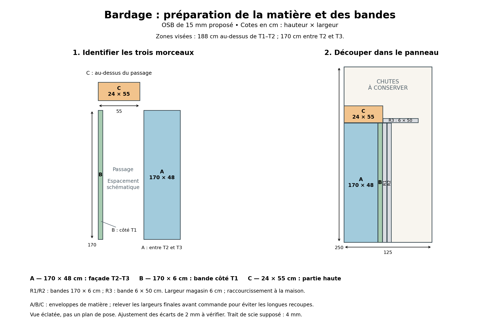
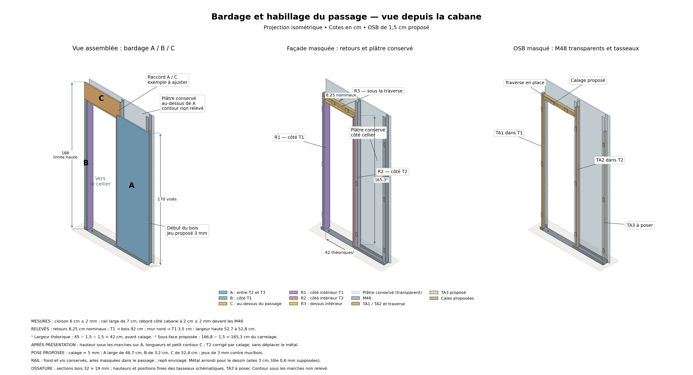
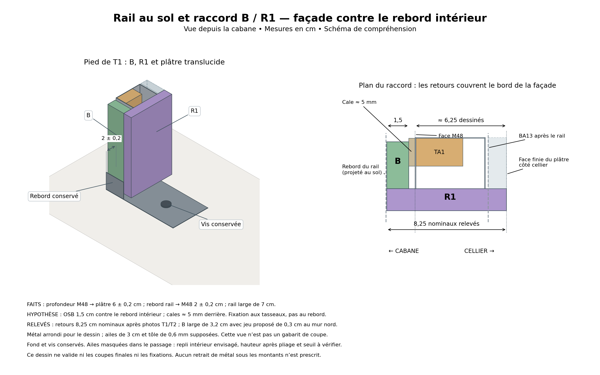
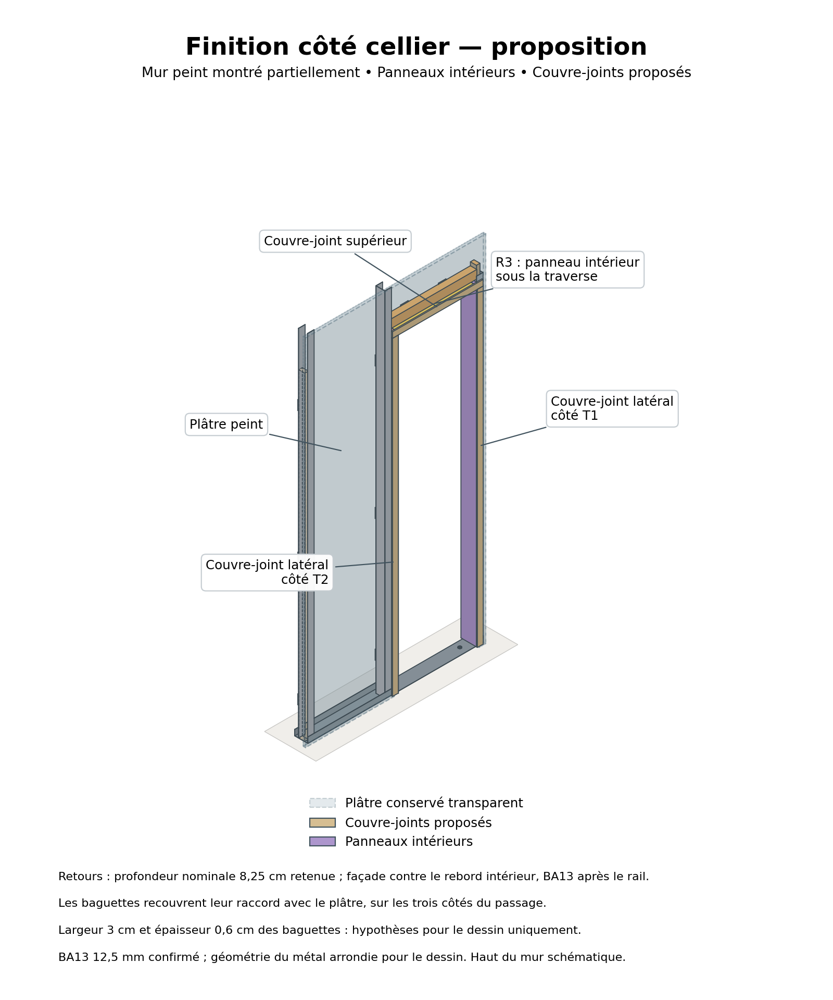

**[Fiche Leroy Merlin + maison — PDF](variante_leroy_maison.pdf)** ·
[Autre variante : six pièces par un atelier — PDF](commande_decoupe.pdf) ·
[Liste d’achat et références](../achats/) · [Fiche détaillée — PDF](decoupes_v1.pdf)

## Variante Leroy Merlin + scie à la maison {#variante-leroy-maison}

**Hypothèse demandée le 29 octobre :** faire les grandes découpes chez Leroy
Merlin, puis B et les trois retours[^retour] avec votre scie japonaise.
Les pièces longues restent d’un seul tenant. La variante où un atelier
découpe les six rectangles reste disponible séparément.

**Matière à choisir :** épaisseur conservée de **1,5 cm**, en OSB/3[^osb]
initialement proposé ou en contreplaqué[^cp] tout peuplier A+ si une référence
est trouvée. Le contreplaqué vu par vous chez Leroy Merlin est **A, pas A+** ;
aucun contreplaqué A+ de ce magasin n’est confirmé. Le placement ci-dessous
utilise un format de **250 × 125 cm** : à recalculer si le panneau choisi
a un autre format. Aucun panneau n’est déclaré acheté.

### Les trois morceaux utiles à demander en magasin

| Repère magasin | Quantité | Longueur × largeur | Utilisation |
|:--|--:|:--|:--|
| **A** | 1 | **170 × 46,7 cm** | Façade entre T2 et T3 |
| **C** | 1 | **24 × 52,4 cm** | Au-dessus du passage |
| **P** | 1 | **170 × 30 cm** | Planche à recouper pour B, R1, R2 et R3 |

Ces formats respectent les minimums publiés de **20 × 20 cm ou 60 × 10 cm**.
La tolérance annoncée est de **±3 mm** : contrôler A et C au retrait, car
elle peut consommer les jeux proposés de 3 mm au mur/bois. Une reprise peut
rester nécessaire ; demander un contrôle avant départ.
[Conditions du service Leroy Merlin, vérifiées le 29 octobre 2026](https://www.leroymerlin.fr/services/decoupe/decoupe-du-bois.html).

**[Fiche imprimable avec l’ordre des coupes — PDF](variante_leroy_maison.pdf)** ·
[Schéma à ouvrir en grand — PDF](schema_leroy_maison.pdf)

### Ce qui reste à scier chez vous

Dans P, tracer et découper successivement **R1 de 8,25 cm**, **R2 de 8,25 cm**,
puis **B de 3,2 cm** sur les 170 cm. Après chaque coupe, repartir du bord
restant pour tracer la bande suivante, sans cumuler les cotes en oubliant
le bois retiré par la lame. Dans le reste, prendre une longueur de **50 cm**, puis
la recouper à **8,25 cm** pour R3. Le schéma de droite montre cet ordre.

**Effort à prévoir : trois coupes de 170 cm et une de 50 cm**, soit environ
**5,6 m de sciage dans la longueur**, plus les coupes en travers et les
ajustements de pose. Les bandes de 170 cm ne sont pas divisées en petits
tronçons. Faire un essai sur une chute[^chute] avant les pièces utiles.

### Transport : encore à vérifier dans votre voiture

Les trois morceaux utiles s’inscrivent, orientés et empilés, dans
**170 × 52,4 cm**, sur **4,5 cm d’épaisseur de bois**. Tester un carton de
**171 × 54 cm** dans la voiture : ouverture du coffre, trajet pour l’insérer,
sièges rabattus et coffre fermé. Ce rectangle laisse une petite marge ; il
ne constitue pas une validation de chargement. Arrimer les panneaux.

**Pour emporter les chutes aussi :** demander le fractionnement complémentaire
du grand reste montré en S3/S4. Le plan donne alors **sept morceaux au total**,
tous dans cette même enveloppe, pour **10,5 cm d’épaisseur de bois** hors
protection. Les cotes S1–S4 dépendent de la largeur réelle de la lame.
Le plan correspond à six coupes droites au total, à confirmer par l’opérateur.
Laisser les chutes sur place est une possibilité uniquement si le magasin
l’accepte. Si 170 cm ne rentre pas, il faut revoir les raccords et leurs
supports avant de couper les pièces longues en deux.

## Découpes à commander

Les six rectangles de l’habillage gardent les cotes ci-dessous, pour un
panneau de **1,5 cm**. Le dessin historique de placement est celui du panneau
**250 × 125 cm** proposé. Les valeurs sont en **cm**.

| Repère | Quantité | Emplacement | Longueur × largeur de préparation |
|:--|--:|:--|:--|
| **A** | 1 | Façade T2–T3, jusqu’au bois voisin | **170 × 46,7 cm** |
| **B** | 1 | Bande côté mur nord / T1 | **170 × 3,2 cm** |
| **C** | 1 | Partie haute au-dessus du passage | **24 × 52,4 cm** |
| **R1** | 1 | Intérieur du passage, côté T1 | **170 × 8,25 cm** |
| **R2** | 1 | Intérieur du passage, côté T2 | **170 × 8,25 cm** |
| **R3** | 1 | Dessus intérieur, sous la traverse | **50 × 8,25 cm** |

Les **largeurs de préparation sont définies** à partir des derniers relevés.
Les longueurs A/B/R1/R2/R3 et la hauteur de C seront raccourcies après
présentation. Le petit décrochement[^decrochement] de C sera reporté sur place.
La variante atelier évite les longues recoupes manuelles ; la variante
Leroy Merlin + maison les réalise dans P, comme indiqué plus haut.

**Autre variante : atelier de coupe pour les six pièces.** [Leroy Merlin](https://www.leroymerlin.fr/services/decoupe/decoupe-du-bois.html)
exclut les formats sous 20 × 20 ou 60 × 10 cm et annonce ±3 mm : les bandes
B/R1/R2/R3 sont hors de ces formats. Pour conserver les jeux proposés de
3 mm sans longue recoupe manuelle, privilégier un atelier capable de tenir
une tolérance d’environ ±1 mm sur l’ensemble de la commande, à confirmer
avec lui. Un atelier de menuiserie acceptant ces petites largeurs peut être sollicité.

[Schéma des découpes — PDF](schema_decoupes.pdf) · [Placement — PDF](debit_preparatoire.pdf)

## Faits et calculs des largeurs

Le passage est entre les montants[^montant] **T1 et T2** ; T2–T3 reste fermé.
La traverse[^traverse] est posée, dessous à **166,8 cm**, dessus à **171,2 cm** ;
les quatre équerres sont au-dessus et le plâtre lui est vissé. TA1/TA2 sont
posés, TA3 en **3,2 × 1,9 cm** reste à prévoir.

- **A :** 92 cm de T1 jusqu’au bois, moins 45 cm jusqu’au plan extérieur
  de R2 maintenu vertical, moins 0,3 cm de jeu proposé contre le bois :
  **46,7 cm**.
- **B :** 3,5 cm entre le mur nord et le bord de T1 côté passage, moins
  0,3 cm de jeu proposé au mur : **3,2 cm**.
- **C :** largeur haute mesurée de 52,7 à 52,8 cm ; on retient 52,7 cm,
  moins 0,3 cm de jeu proposé au mur : **52,4 cm**.
- **R1/R2/R3 :** profondeur nominale **8,25 cm**, retenue après les relevés
  près de T1 et de T2. Les photographies ne garantissent pas une précision
  au demi-millimètre ; cette valeur est une cote nominale de préparation.

Les hauteurs souhaitées sont **188 cm au-dessus du passage** et **170 cm
sur A**. La hauteur minimale sous les marches sur A reste à vérifier avant
recoupe finale. Le jeu de 0,3 cm est proposé ; les instructions du panneau
acheté priment.

## Vue depuis la cabane

[Vue côté cabane — PDF](isometrie_bardage_v1.pdf)

Les trois vues montrent successivement la façade, les retours[^retour],
puis les tasseaux[^tasseau] et la traverse derrière l’OSB masqué. Le BA13[^ba13]
conservé est transparent, y compris au-dessus de A, à droite de C. Son
contour supérieur est tronqué schématiquement à 188 cm et ne prescrit
aucune coupe du plâtre. Les hauteurs et positions fines des tasseaux sont
schématiques ; l’orientation du profil de T3 reste inconnue.

**R1/R2/R3 couvrent les bords de la façade jusqu’à sa face visible.** R1/R2
montent sous la traverse et R3 s’insère entre eux. C présente un petit
décrochement au raccord avec A : sa forme sera reportée après présentation.
Les baguettes d’angle[^corniere] proposées se posent après vissage ; prévoir
leur place avant. Elles ne sont pas représentées dans cette vue.

## Rail, calage et raccord B / R1

[Rail et raccord — PDF](detail_rail_raccord_v2.pdf)

Le rail[^rail] mesure environ **7 cm** ; son rebord côté cabane est à environ
**2 cm ± 2 mm** devant les M48. La façade est proposée contre la face
intérieure du rebord, avec environ **0,5 cm de cales[^cale]** aux appuis.
Elle reste vissée aux tasseaux ; le rebord ne remplace pas cette fixation.
Le BA13 de **1,25 cm confirmé** se trouve après le rail, sans chevauchement.
La vue utilise une géométrie du métal arrondie ; elle ne sert pas de gabarit.
La profondeur de préparation des retours est le nominal relevé de **8,25 cm**.

**Fond, vis et parties sous T1/T2 conservés.** Le repli intérieur des ailes
est désormais envisagé, après coupes verticales aux limites du passage.
Il n’est pas déclaré réalisé. Les ailes sont masquées dans l’ouverture sur
les vues ; leur hauteur après pliage reste à vérifier pour le seuil et les
pieds de R1/R2. Les 3 cm de hauteur d’aile et 0,6 mm de tôle du dessin sont
des hypothèses, pas des mesures.

## Vue depuis le cellier

[Vue côté cellier — PDF](isometrie_cellier_v1.pdf)

Les retours arrivent à la face peinte du plâtre. Trois couvre-joints[^couvrejoint]
peuvent masquer le raccord : deux verticaux et un horizontal. Le champlat[^champlat]
chêne envisagé figure dans la [liste d’achat](../achats/). Les sections des
baguettes dessinées sont illustratives et restent à comparer aux profils achetés.

## Ajustements restant chez soi

- **A :** vérifier le passage sous les marches sur toute la largeur ;
  raccourcir la hauteur pour viser un haut à 170 cm avec l’espace au sol retenu.
  Avec un bas à 1 cm, sa hauteur serait de 169 cm. Ce centimètre reste une
  proposition, pas une obligation établie.
- **B :** raccourcir sous la traverse, dont le dessous est à **166,8 cm**.
- **R1/R2 :** raccourcir entre leur niveau bas réel au-dessus du rail aménagé
  et la traverse, en laissant le petit espace de pose retenu. Une cale
  provisoire sous le panneau se retire après vissage ; les cales d’appui derrière
  le panneau restent en place.
- **R3 :** mesurer sa longueur entre R1 et R2 présentés. Les **42 cm**
  calculés à partir de 45 moins deux épaisseurs de 1,5 ne sont pas une coupe finale.
- **C :** présenter le rectangle de 24 × 52,4 cm, puis reporter la hauteur et
  le petit décrochement au raccord avec A. Avec un haut à 187,7 cm et un bas
  à 166,8 cm, sa hauteur serait **20,9 cm**. Le contour doit respecter les
  pièces de l’escalier et le raccord réel ; ne pas le découper d’après la seule
  vue 3D.

## Hypothèses et sécurité

Les jeux proposés, le calage et le décrochement de C sont à vérifier après
présentation. La largeur théorique du passage serait de 42 cm avant calage
et baguettes ; la sous-face de R3 serait à 165,3 cm du carrelage avant seuil.
Conserver les fixations et les éléments de l’escalier. Les dessins expliquent
l’assemblage, sans certifier sa résistance ni les vis à choisir.

Pour scier chez vous, maintenir le morceau conservé sur une table stable
avec les deux serre-joints[^serrejoint]. Dégager le trajet de la lame de la
table et du métal. Repositionner le panneau après arrêt de la coupe si
nécessaire ; soutenir la bande en fin de coupe sans coincer la lame. Poncer
les bords. La fiche ne valide pas une installation de sciage non observée.

[^osb]: **OSB** : panneau de grandes lamelles de bois collées ; l’OSB/3 n’est pas imperméable.
[^cp]: **Contreplaqué** : panneau constitué de fines feuilles de bois collées en couches croisées.
[^chute]: **Chute** : morceau restant après découpe.
[^serrejoint]: **Serre-joint** : outil maintenant fermement une pièce contre la table.
[^decrochement]: **Décrochement** : petit changement de contour, ici une découpe en angle permettant à C de rejoindre A.
[^montant]: **Montant** : profil métallique vertical ; T1, T2 et T3 sont ceux du nord vers le sud.
[^traverse]: **Traverse** : bois horizontal placé au-dessus du passage.
[^retour]: **Retour** : panneau couvrant l’épaisseur de la cloison à l’intérieur du passage.
[^rail]: **Rail** : profil métallique en U posé au sol ; ses ailes sont les deux rebords verticaux.
[^cale]: **Cale** : pièce rigide interposée pour régler la position ou l’appui d’un panneau.
[^ba13]: **BA13** : plaque de plâtre à bords amincis, d’épaisseur 1,25 cm ici confirmée.
[^tasseau]: **Tasseau** : pièce de bois servant de support aux vis de l’habillage.
[^couvrejoint]: **Couvre-joint** : baguette masquant le raccord entre deux surfaces.
[^corniere]: **Baguette d’angle**, ou cornière : profil en L couvrant deux faces perpendiculaires.
[^champlat]: **Champlat** : baguette plate et mince.
